<picture></picture>

<h3><samp>› contact: <a href="https://www.linkedin.com/in/oliwier-pyrzak">linkedin.com/in/oliwier-pyrzak</a> · <a href="mailto:oliwierpyrzak@proton.me">oliwierpyrzak@proton.me</a></samp></h3>

<samp>🌑 built in the dark.</samp>

