<picture></picture>

<samp><b>more info</b></samp>

 

<samp>

<b>Now</b> 
› final year of technikum: programming technician (technik programista), ZS Grójec 
› learning Rust, one exercise per topic 
› next: security tooling in Rust and Python

<b>Side projects</b> 
› <b>factory game</b> · Roblox · private 
&nbsp;&nbsp;I write the spec and run it like a real project: stages, a QA gate before each one ships, pull requests, clean history. The code is written by AI agents (Claude Code), one developing and one reviewing as QA, under rules I set. 
› <b>PoE2 market bot</b> · Python · with another developer 
&nbsp;&nbsp;Trade alerts, price checks and on-screen item detection for Path of Exile 2.

<b>Stack</b>

<picture></picture>
<picture></picture>
<picture></picture>
<picture></picture>
<picture></picture>
<picture></picture>
<picture></picture>

<b>Looking for</b> 
A first job or internship in cybersecurity (SOC, pentesting) or as a junior developer. Remote or hybrid, Grójec / Warsaw.

<b>Contact</b> 
<a href="https://www.linkedin.com/in/oliwier-pyrzak">linkedin.com/in/oliwier-pyrzak</a>

</samp>

<samp>🌑 built in the dark.</samp>

